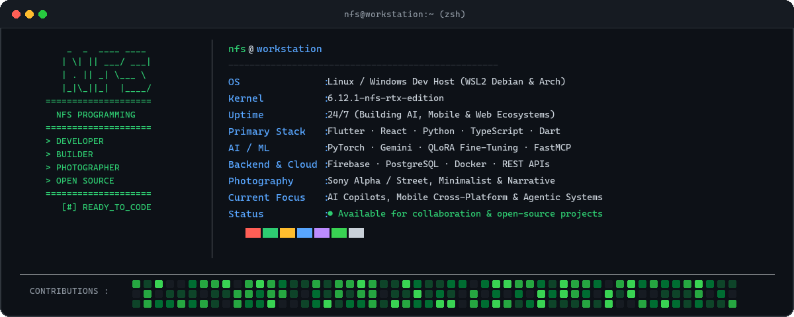

# NFS Programming

**Developer · Builder · Photographer**

Building clean, useful software and capturing the world through a lens.

---

## ⚡ About Me

- 💻 **Software Engineering**: Cross-platform mobile & desktop apps (Flutter/Dart), modern reactive web systems (React, Vite, Next.js, TypeScript), and distributed backend architectures.
- 🤖 **AI & Agentic Systems**: Building intelligent copilots, real-time voice assistants (FastMCP, Gemini API), and local model fine-tuning (QLoRA, PyTorch).
- 📷 **Visual Arts**: Street, minimalist, and fine-art photography—finding symmetry in raw light and architecture.
- 🚀 **Currently Building**: Production-grade ERP platforms, health-tech assistants, and offline-first tooling.
- 📫 **Reach Me**: Open for engineering collaborations, open-source work, and creative discussions.

---

## 🛠️ Tech Stack

### Languages

### Frameworks & Libraries

### Cloud, Backend & DevOps

---

## 🌟 Featured Open-Source Repositories

| Repository | Description | Primary Stack |
| :--- | :--- | :--- |
| [**NEXERP-AI**](https://github.com/nfsprogramming/NEXERP-AI) | Enterprise Cloud ERP system with Dual-Engine AI Copilot (offline deterministic & Google Gemini) | `TypeScript` `React` `Gemini AI` |
| [**TerraMesh-AI**](https://github.com/nfsprogramming/TerraMesh-AI) | AI-powered mine subsidence monitoring & safety command center with IoT edge telemetry & 3D digital twin | `Python` `AI/IoT` `GIS` |
| [**Care-Connect-AI**](https://github.com/nfsprogramming/Care-Connect-AI) | Responsive healthcare assistant & patient support web portal with offline clinical decision rules | `JavaScript` `React` `Healthcare AI` |
| [**F.R.I.D.A.Y**](https://github.com/nfsprogramming/F.R.I.D.A.Y) | Real-time AI voice assistant and FastMCP server with LiveKit Agents, Gemini, and Three.js visualizer | `Python` `LiveKit` `FastMCP` |
| [**Fine-Tune-LLM**](https://github.com/nfsprogramming/Fine-Tune-LLM) | Self-hosted AI coding agent platform: 4-bit QLoRA fine-tuning, RAG intelligence, and Docker sandbox | `Python` `PyTorch` `QLoRA` |
| [**Untoldable-Lines-Portfolio**](https://github.com/nfsprogramming/Untoldable-Lines-Portfolio) | Evocative, minimalist poetry and creative works showcase web application | `React` `Vite` `Framer Motion` |

---

## 📊 GitHub Analytics

  

---

## 🤝 Connect & Socials

---

Design: terminal / Neofetch-inspired profile card · Maintained by @nfsprogramming

